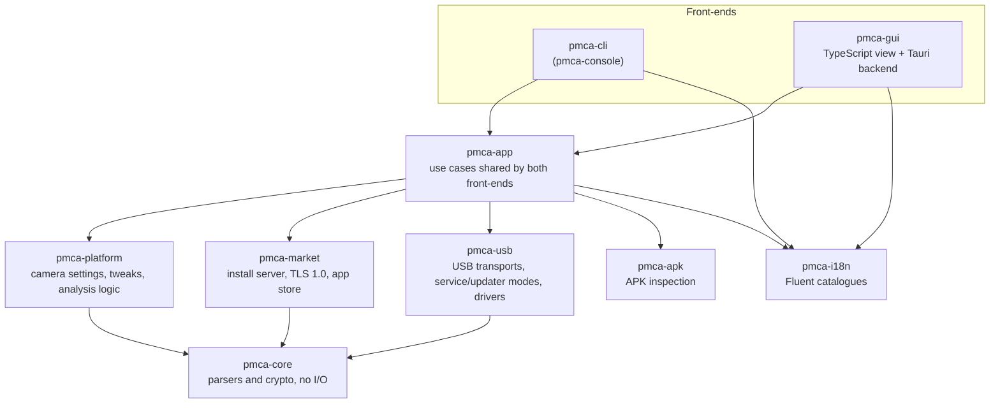
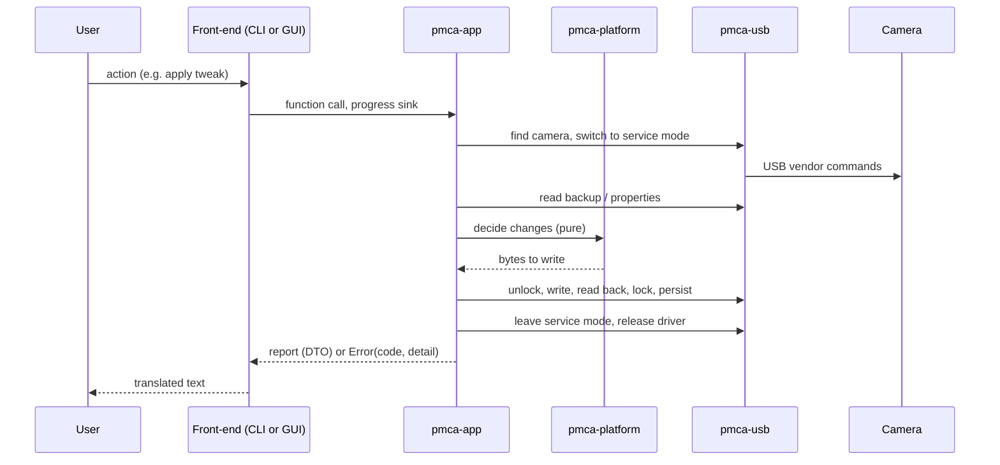

# Architecture

A short map of how PMCA-RE RELOADED is put together: which part does what, how
data travels between the camera and the user, and which rules every part
follows. The details are in each crate's module documentation (`cargo doc`);
this page is the overview to read first.

## 1. Layers

The arrows point from user to dependency. Three rules keep this shape:

* **Front-ends hold no logic.** `pmca-cli` and the Tauri backend parse input,
  call one function in `pmca-app` and render the result. A line typed in the
  console and the same action clicked in the window run the same code. The CLI
  reaches `pmca-usb` directly only for the two things that exist nowhere else:
  the elevated `driver` command and the interactive updater-shell tunnel.
* **Decisions are made without hardware.** What to write, which property a
  menu setting lives in, whether a value may be written: all of that sits in
  `pmca-platform` and `pmca-core`, works on byte buffers and is unit-tested
  without a camera. `pmca-usb` only moves bytes.
* **Unsafe code stays at the edges.** `pmca-usb` denies it and allows it only
  in its Windows modules (driver installation, SCSI pass-through, WPD, host
  services); `pmca-cli` needs it for the console code page. `pmca-core`,
  `pmca-platform`, `pmca-market`, `pmca-apk`, `pmca-app`, `pmca-i18n` and the
  Tauri backend forbid it outright.

## 2. The crates in one sentence each

| Crate | Responsibility |
|---|---|
| `pmca-core` | Bounds-checked parsers for `Backup.bin`, firmware `.dat`, SPK, usage log, photos; checksums and crypto helpers. No I/O. |
| `pmca-platform` | Named camera settings on top of a backup image (`BackupPatch`) or single properties (`DirectPatch`), the tweak catalogue, the read-only identity values, and the pure part of the function analysis. |
| `pmca-usb` | Finding the camera and talking to it: mass storage, MTP/WPD, Sony's vendor commands, service (senser) mode, updater mode, and assigning WinUSB on Windows. |
| `pmca-market` | The local HTTPS server the camera installs apps from, including the TLS 1.0 stack old cameras need, and the community app-store client. |
| `pmca-apk` | Reads an APK's manifest so an install can be checked before it starts. |
| `pmca-app` | The use cases: install, tweaks, analysis, service and updater sessions, network settings, firmware, file tools. Owns progress reporting and the error type both front-ends translate. |
| `pmca-i18n` | Loads the 21 Fluent catalogues compiled into the binary, plus per-user corrections. |
| `pmca-cli` | `pmca-console`: argument parsing (`main.rs`) and one module per group of subcommands (`commands/`). |
| `pmca-gui` | Tauri application: `src/` is the window (TypeScript, no framework; shared helpers beside `main.ts`, one module per page in `views/`), `src-tauri/` the backend that exposes `pmca-app` as commands (`commands/`, one module per page). |

## 3. How a camera operation runs

* **Progress** travels through a `ProgressSink`. The CLI prints each event; the
  GUI forwards it as the `pmca://progress` event to the status line of the
  visible page.
* **Results** are plain serialisable DTOs (`pmca_app::dto`, analysis types in
  `pmca_app::analysis`). Their TypeScript shapes are generated by ts-rs when
  `cargo test -p pmca-app` runs, into `crates/pmca-gui/src/bindings/`; the
  window imports them, and CI fails when the committed files are stale.
* **Errors** carry a stable `code`, an optional `detail` and an optional
  `recovery` action (switch to mass storage, start the driver helper, write
  the whole image). Front-ends look up `err-<code>` in the catalogue; a
  message that is already localised is shown as is.

## 4. Rules for writing to a camera

Writing to the camera's settings memory is the one thing that can leave a
camera in a state only a service centre fixes. Every write path follows the
same order:

1. **Read first.** The current value is read from the camera, not taken from
   an earlier session.
2. **Save the way back** before the first byte is written: a rollback record
   per camera (`rollback/<model>-<serial>.json`, the analysis keeps its own
   `-analysis` record) or, for whole-image writes, the image itself.
3. **Write, read back, compare.** A value that did not stick is undone, and the
   values written before it as well.
4. **Lock and persist**, whatever happened in step 3.
5. **Leave service mode and release the driver** on every exit path, including
   errors (guards with `Drop`).

On top of that the function analysis writes only a value the camera produced
itself, only for exactly one unambiguous small candidate, only after explicit
consent, and only to the camera it analysed (checked by model and serial number
before writing and restoring).

Paths that write today: tweaks (whole image or per property), the analysis
write test and its restore, restoring an interrupted test, and `bk w` in the
service shell. Unifying them behind one guarded API is planned. In the window,
every button that changes the camera carries the same red write badge as the
analysis steps.

Files are written only where the user chose in a native dialog: report and
catalogue exports, the usage log and the APK/SPK converters open the save
dialog in the backend, so the window never hands over a path to write to.

## 5. Privileges and drivers (Windows)

Service mode needs WinUSB on the camera, and assigning a driver needs
administrator rights. The rest of the program does not.

* The driver package is generated, signed with a throw-away certificate and
  removed again at the end of every session, because WinUSB on the camera's
  mass-storage interface disables mass storage and the updater.
* A **sweep at every start** removes packages and certificates an earlier run
  left behind and asks a camera stranded in service mode to leave it.
* The window and the console stay unelevated. When a driver has to change,
  `pmca_app::drivers` starts the same executable once more, elevated, with
  `--pmca-driver-helper` (one UAC prompt per program session). The helper
  answers only three requests over a named pipe — bind a Sony device, unbind
  everything, sweep — and refuses anything else.
* The pipe is created with a DACL for the current user only, rejects remote
  clients, allows one instance and checks the client's process id against
  the program that started it; the client checks the server's process id in
  turn. The helper releases all bindings and exits when its parent ends or
  the pipe closes.
* Startup only sweeps directly (succeeds when the program itself runs
  elevated); otherwise leftovers are swept through the helper before the
  next session starts.

## 5a. Key material

The keys the protocols need — the service-mode authentication keys, the CIC
HMAC key, the SPK key material and the keys for updater images — are **not**
in this source tree.
`pmca_core::keystore` holds only each key's SHA-256 digest and length. The user
imports the keys from a source of their own choosing (`pmca_app::keys`): the
source is downloaded over https, scanned for byte-string literals, decimal
integers and raw byte windows, and every candidate whose digest matches is
kept. No source is suggested by the program. Imported keys live in the user's
profile (`keys/`), loaded at start-up and re-verified each time.

Without a key, the operations that need it fail with a dedicated error
(`missing-keys`) carrying the `import-keys` recovery action, while everything
that needs no key — camera info, shutter count, photos, GPS, Wi-Fi and
streaming settings, official firmware updates, the usage log — keeps working.

## 6. State and storage

| What | Where | Lifetime |
|---|---|---|
| Rollback records, saved images | `%APPDATA%\PMCA-RE-RELOADED\rollback\` | until undone; five images per camera |
| Imported key material | `%APPDATA%\PMCA-RE-RELOADED\keys\` | until removed; one file per key, owner-only where supported |
| Analysis reports | `%APPDATA%\PMCA-RE-RELOADED\analysis\` | kept |
| Translation corrections | user data folder, via the settings page | until reset |
| GUI preferences | WebView `localStorage`: `pmca.theme`, `pmca.locale`, `pmca.advanced`, `pmca.analysis`, `pmca.analysis.form` | per user |
| Open sessions | Tauri `AppState` (service, updater, tweak session, analysis run) | process; closed when the page or window closes |

All camera operations in the GUI run on worker threads under one camera lock,
so a mode switch can never overlap another operation.

## 7. Localisation

* One catalogue per language in `locales/<tag>/pmca.ftl`, compiled into the
  binary. CLI and GUI use the same keys.
* Every language defines every key; a test fails the build otherwise, and
  `tools/check-locales.ps1` reports parity, byte-order marks and line endings.
  A test also refuses a translated placeholder (`{ $path }`).
* `tools/apply-locale-blocks.ps1` applies one block of new or changed lines
  per language to all catalogues; `tools/find-unused-keys.ps1` lists keys no
  source file mentions.
* The window parses the catalogue itself and supports only single-line values,
  so multi-step instructions are written as `1. … 2. …` on one line and broken
  up for display.

## 8. Experimental and guarded features

| Feature | Guard |
|---|---|
| Service and updater shell in the window | Settings → Advanced mode, with confirmation |
| Function analysis | Settings → Function analysis, off by default; write test needs a consent dialog and a second confirmation |
| Whole-image tweak write | offered only after the camera refused single values, with its own confirmation |
| Firmware flashing (CLI) | `--flash` and `--confirm` |

## 9. Where to start reading

* A use case end to end: `crates/pmca-app/src/tweaks.rs` (session handling,
  both write paths, on top of `service_mode.rs`) or
  `crates/pmca-app/src/analysis/` (`run.rs`: snapshots and write test,
  `cross_check.rs`, `report.rs`).
* The decisions behind a write: `crates/pmca-platform/src/lib.rs`
  (`BackupPatch`) and `crates/pmca-platform/src/analysis.rs`.
* How the camera is reached: `crates/pmca-usb/src/discovery.rs` and
  `crates/pmca-usb/src/senser_camera.rs`.
* Driver rights: `crates/pmca-app/src/drivers.rs` and
  `crates/pmca-usb/src/winusb_install/helper_pipe.rs`.
* How the GUI exposes it: `crates/pmca-gui/src-tauri/src/commands/`.
* Parsers under attack: the targets in [fuzz/](fuzz/README.md).
