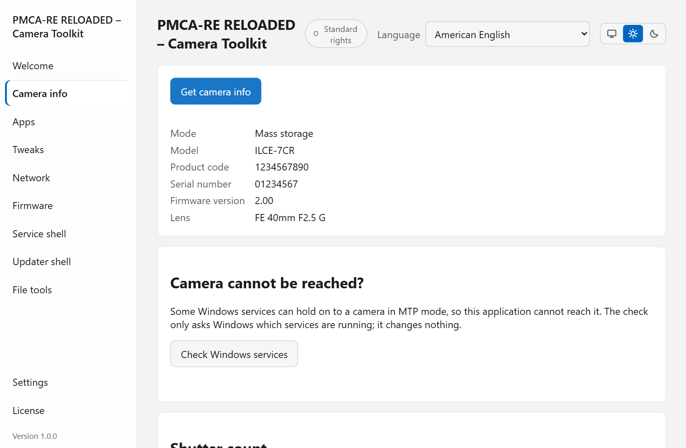
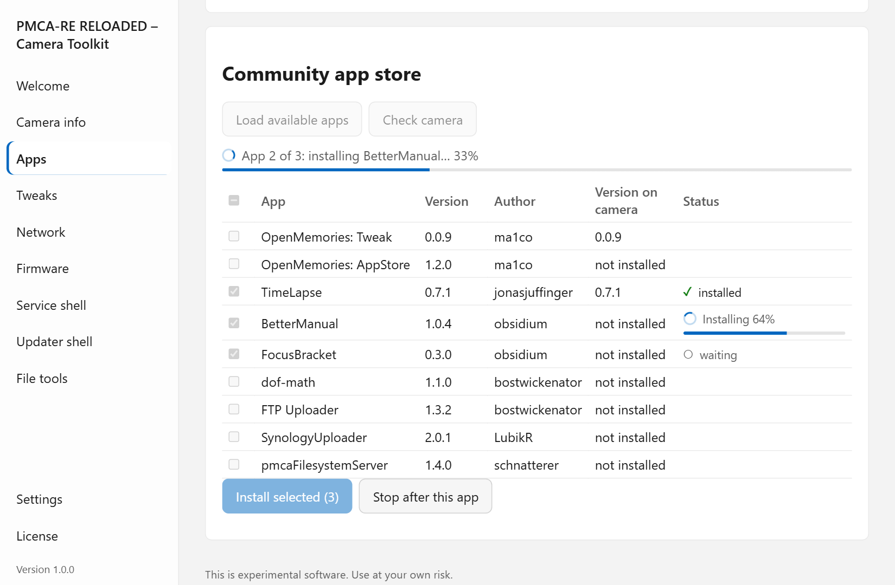
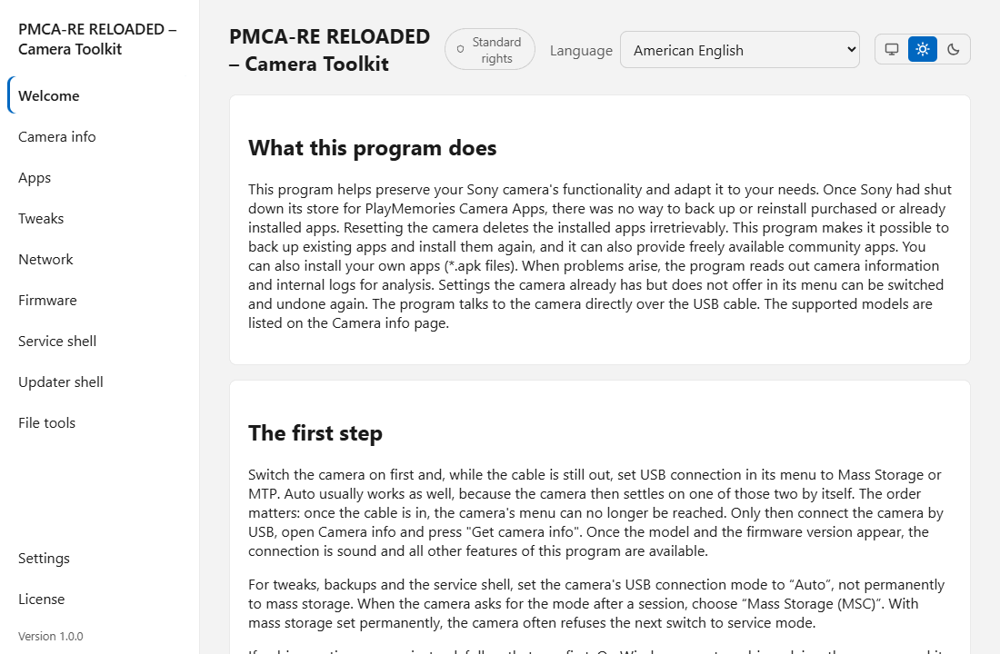

<p align="center">
  
</p>

<h1 align="center">PMCA-RE RELOADED</h1>

<p align="center">
  <b>A desktop toolkit for Sony cameras — over plain USB, on Windows, macOS and Linux.</b><br>
  Camera information, apps, firmware and the camera's settings memory, in one application.
</p>

<p align="center">
  <a href="https://github.com/masterflai/pmca-re-reloaded/releases/latest"></a>
  <a href="https://github.com/masterflai/pmca-re-reloaded/actions/workflows/ci.yml"></a>
  
  
  <a href="LICENSE.txt"></a>
</p>

<p align="center">
  <a href="https://github.com/masterflai/pmca-re-reloaded/releases/latest"><b>Download</b></a> ·
  <a href="#getting-started">Getting started</a> ·
  <a href="#what-it-does">What it does</a> ·
  <a href="#supported-devices">Supported devices</a> ·
  <a href="#publish-your-own-apps-and-plugins"><b>Publish apps &amp; plugins</b></a> ·
  <a href="#safety">Safety</a> ·
  <a href="CHANGELOG.md">Changelog</a>
</p>

<p align="center">
  <picture>
    <source media="(prefers-color-scheme: dark)" srcset="docs/images/camera-info-dark.png">
    
  </picture>
  <picture>
    <source media="(prefers-color-scheme: dark)" srcset="docs/images/app-install-dark.png">
    
  </picture>
</p>

PMCA-RE RELOADED talks to Sony cameras and other Sony imaging devices through
their USB interfaces — from early NEX and Alpha bodies to current models, and
from compact cameras to action cameras. What a device offers depends on its
generation; the *Camera info* page shows what applies to the one connected.
It reads what the device knows about itself, installs apps although Sony's app
store has closed, runs firmware updates, and gives careful, reversible access
to the settings memory.
It is a desktop application with a command line beside it, written from scratch
in Rust, and it needs neither Python nor extra driver tools.

> **Independent project.** Not made by, endorsed by, or connected to Sony.
> "Sony", "PlayMemories", "α"/"Alpha" and the camera model names are trademarks
> of Sony Group Corporation, used only to say which cameras this tool speaks to.
> **Use it with cameras you own.** Some functions change settings inside the
> camera and may affect your warranty — read [Safety](#safety) first. The
> software comes without warranty; see [LICENSE.txt](LICENSE.txt).

## Why PMCA-RE RELOADED

| | |
|---|---|
| **One app, three systems** | A desktop app for Windows, macOS and Linux, plus `pmca-console` for scripts and experts. Both share the same core. |
| **No driver hunting** | Most tasks use the drivers your system already has. Where raw USB is unavoidable, the program assigns the driver itself — no Zadig — and removes it again afterwards. |
| **Safety net built in** | Every write to the settings memory is preceded by a saved copy, read back and compared, and can be rolled back. |
| **Your keys, not ours** | No Sony key material and no Sony firmware files ship with the program. Functions that need keys use material you import yourself. |
| **Private by design** | No telemetry, no account. The network is used only by the features that obviously need it, and only when you use them. |
| **Extensible** | Plugins add languages, compatibility notes, settings and sandboxed WebAssembly tools. |
| **Open to every developer** | Anyone can publish camera apps and plugins from a GitHub repository of their own — no store, no approval, no central hosting. Users add the sources they choose. [How to publish](#publish-your-own-apps-and-plugins) |
| **27 languages** | Every text is translated, and each translation can be edited from within the app. |

## What it does

<p align="center">
  <picture>
    <source media="(prefers-color-scheme: dark)" srcset="docs/images/demo-dark.gif">
    
  </picture>
</p>

**Camera information** — model, firmware version, serial number and USB mode at
a glance; the shutter count, read from any ARW, JPEG or HEIF photo the camera
took; and the camera's usage log, decoded. No keys and no driver change needed.

**Apps** — Sony's PlayMemories store has been shut down; installing apps still
works. Install an `.apk` file you have, or pick one from the
[sources](#app-and-plugin-sources) you have added. Recommended start:
[OpenMemories: Tweak](https://github.com/ma1co/OpenMemories-Tweak).
The apps installed on your camera can be backed up to your computer and
installed again later, even once their source is gone. The backup restarts the
camera into its update mode and only reads its app storage.

**Firmware** — check an official Sony firmware file against the connected camera
and install it, or start the updater shell: the camera boots its update mode
and runs this project's own code instead of an update, so the installed firmware
stays untouched. The update image for that is generated on your computer.
*Flashing official firmware is ported but has not yet been tried on a camera —
treat it as experimental.*

**Settings memory** — read and change settings the camera has but does not show
in its menu, such as the video recording limit, all menu languages or the
PAL/NTSC video system. Each change is backed up, verified and reversible.

**Function analysis** *(experimental)* — find out in which value of the
settings memory one of the camera's own menu settings is stored, and compare
the finding with other cameras. Reading only, unless you ask for a write test.

**Network settings** — GPS assist data, and the access points and settings of
the live-streaming feature.

**File tools** — inspect backup images, usage logs and firmware files offline.

**Expert shells** — the service shell and the updater shell give direct access
to the camera's Linux system. Hidden behind an *Advanced mode* switch in the
app, so reaching them stays a deliberate step.

## Getting started

1. **Download** the [latest release](https://github.com/masterflai/pmca-re-reloaded/releases/latest)
   for your system (see [Downloads](#downloads)) and start it.
2. **Connect the camera** by USB. In the camera's menu, set *USB Connection* to
   *Mass Storage* or *MTP*. The *Welcome* page explains what to expect.
3. **Optional: import key material.** App installation, the settings memory and
   function analysis need keys that do not ship with the program. While any are
   missing, the *Welcome* page shows an import panel — see [Key material](#key-material).

Everything is also available on the command line; `pmca-console --help` lists
the commands, for example `pmca-console info`, `pmca-console install --apk <file>`
or `pmca-console tweaks`.

## Supported devices

What works depends on the camera's generation, not on this program:

| | Camera info, shutter count, usage log | Apps | Firmware, updater shell | Settings memory, service shell |
|---|:-:|:-:|:-:|:-:|
| **Cameras with PlayMemories Camera Apps** (NEX, α, RX and other Cyber-shot models of roughly 2012–2017) | ✔ | ✔ | ✔ | ✔ |
| **Newer Sony cameras** (roughly 2018 onwards) | ✔ | ✖ | ✖ | many models |
| **Other Sony imaging devices** (camcorders, action cameras, compacts without app support) | ✔ | ✖ | model-dependent | model-dependent |

The exact list is in the app: *Camera info → Compatible devices* shows every
known model with its processor generation and which functions apply, and
*More devices* adds further models together with what the community has
reported. Before a function changes anything, the program checks the
connected model against this list and warns when it is untested.

The shutter count does not even need the camera: it is read from any photo
the camera took. If you have used the program with a model, a
[camera report](https://github.com/masterflai/pmca-re-reloaded/issues/new?template=camera_report.yml)
helps everyone else.

## Downloads

| System | Desktop app | Command line |
|---|---|---|
| **Windows** (x64) | `…_x64-setup.exe` (installer) · `…_x64_en-US.msi` · `pmca-gui-portable-x86_64-windows.zip` (no installation) | `pmca-console-x86_64-windows.zip` |
| **macOS** (Apple silicon and Intel) | `…_universal.dmg` | `pmca-console-aarch64-macos.tar.gz` · `pmca-console-x86_64-macos.tar.gz` |
| **Linux** (x64) | `….AppImage` (portable) · `…_amd64.deb` | `pmca-console-x86_64-linux.tar.gz` |

**Windows** — The portable `.zip` runs from any folder, a USB stick included;
keep the `bodyfs` folder next to `pmca-gui.exe`. The window needs the WebView2
runtime, which Windows 11 has and Windows 10 may not. Settings and edited
translations are kept in your user profile.

**macOS** — The `.app` in the `.dmg` runs from any folder. Close applications
that might access the camera (Photos, cloud sync tools) before connecting it,
and set the camera's USB connection to MTP. Tweaks, the service shell, the
function analysis, firmware updates and the updater shell go through the
camera's mass-storage connection, which macOS hands to a program only when it
runs with administrator rights. The app asks
for your password once per run and does the rest itself; on the command line
use `sudo`, for example `sudo ./pmca-console serviceshell`. With the USB
connection set to Auto or Mass Storage, reading the camera information asks
for the password too. The camera's card
leaves Finder while this runs and comes back afterwards, so eject it there
first if files on it are open.

**macOS 26:** for now only reading the camera information works, with the
camera's USB connection set to MTP. The service menu cannot be reached yet:
the tweaks, the service shell, the function analysis, firmware updates and the
updater shell all need the camera's mass-storage connection, and macOS 26 no
longer hands it to a program, even with administrator rights. This is being
investigated.

**Caution:** firmware updates and the updater shell have not yet been tried
on a Mac with a camera. An update that breaks off can leave the camera unable
to start. Until a successful update on a Mac has been reported, update the
firmware from Windows or with Sony's own updater.

**Linux** — Make the `.AppImage` executable and run it, or install the `.deb`.
[`scripts/linux-prepare.sh`](scripts/linux-prepare.sh) sets up the udev rule
for Sony's vendor id and stops the desktop from claiming the camera.

The Linux build of version 1.2.0 has been tried on a Sony α6000 (ILCE-6000,
firmware 3.21) with *USB Connection* set to *Auto*: reading the camera
information, reading and changing the settings memory and installing apps all
worked. The macOS build has been tried only in
part so far. Reports are welcome — see [Feedback](#feedback).

### Signatures

The Windows downloads are to be signed through SignPath (see the
[code signing policy](#code-signing-policy)); the release notes say whether a
given release is. Until then, and on the other systems:

* **Windows** shows a SmartScreen warning for an unsigned release: *More info* → *Run anyway*.
* **macOS** refuses to open the app on first start, or reports it as
  *damaged*. It is not — the file carries a quarantine flag. Open
  *System Settings → Privacy & Security*, scroll to *Security* and click
  *Open Anyway* (macOS 15 and later no longer offer this through right-click →
  *Open*). Alternatively run
  `xattr -dr com.apple.quarantine "/Applications/PMCA-RE RELOADED.app"`.
* **Linux** starts the packages without complaint.

Every download has a `.sha256` file beside it, which confirms that the file
arrived intact.

## Key material

Some camera protocols need keys that are not part of this program: the
service-mode authentication keys, the checksum key for app installation, the
key material that packs an app for the camera, and the keys for firmware
update images. Without them, app installation, the settings memory, function
analysis and the updater shell are unavailable. Everything else works without
any setup.

The program contains only the SHA-256 digests of this material. You supply the
material from a source of your own choosing — in the app via the panel on the
*Welcome* page, or with `pmca-console keys import <url or file>`. The program
reads the source, keeps only byte sequences whose digest matches, and stores
them in your user profile. Nothing from the source is executed, and nothing is
sent anywhere.

The program names no source. **Observe the laws that apply where you are, and
work only with cameras and data that are your own.**

## Drivers on Windows

Most functions use the drivers Windows has already installed: mass storage
mode works through SCSI pass-through, MTP mode through the Windows Portable
Devices API. If a camera is refused in one of these modes, do not replace its
driver.

Only service mode — used by the settings memory, function analysis and the
service shell — needs raw USB access through **WinUSB**. The program handles
that itself:

* It builds a minimal driver package for the camera it found and signs it with
  a short-lived certificate created on the spot (valid one day, code signing
  only, private key never written to disk). The certificate sits in the
  machine's trust stores only for the few seconds Windows needs to accept the
  package, and is removed right after.
* Neither the app nor the console has to run as administrator. The first time a
  driver must change, a small helper asks for administrator rights once per
  session; it only assigns and removes drivers for Sony devices and ends with
  the program.
* When the session ends, the driver packages are removed and the camera returns
  to the drivers Windows chose. A clean-up at program start removes anything a
  crash may have left behind; `pmca-console driver unbind` does the same by hand.
* Drivers that Zadig installed for a Sony camera — the original Sony-PMCA-RE
  asked for that — stay in Windows and take the camera before this program's
  driver can, which makes service mode fail. The app finds them at start and
  offers to remove them; on the command line, `pmca-console driver zadig`
  lists them and `--remove` removes them.

Power-cycling the camera always returns it to normal mode.

## App and plugin sources

Apps and plugins from other developers come from **sources**: public GitHub
repositories in which their authors publish them. The program ships no source,
hosts nothing and checks nothing; the author of a source alone is responsible
for it. You add the sources you choose — in the app under *Settings → App and
plugin sources*, or with `pmca-console sources add owner/repository`.

* Two lists are offered there as suggestions you can switch on: the app list of
  the original project, kept by ma1co, and
  [pmca-community-sources](https://github.com/masterflai/pmca-community-sources),
  kept by the author of this program, which points to the own releases of apps
  whose authors have archived their projects, and of apps whose authors asked
  to be listed, such as [JPEGCAM](https://jpeg.cam).
* *Search GitHub* (`pmca-console sources search`) lists repositories with the
  topic `pmca-source`, with their GitHub stars. The search only runs when you
  ask, and its results are no recommendation: look at a repository before you
  add it.
* The first time an app or plugin is downloaded from a source, the program
  remembers who signed it, and refuses a later version signed by someone else.

To publish your own apps or plugins, see
[Publish your own apps and plugins](#publish-your-own-apps-and-plugins).

## Publish your own apps and plugins

You do not need anyone's permission to offer camera apps or plugins to users
of PMCA-RE RELOADED, and nobody reviews or hosts them for you. Your work stays
in your own GitHub repository, under your name and your license:

1. **Build** your app (a signed `.apk` for the camera) or your plugin
   (`pmca-console plugins pack <folder> <file> --key <keyfile>`, with a key
   from `pmca-console plugins keygen`).
2. **Release** it on GitHub: attach the `.apk` or `.pmcaplugin` to a release
   of the repository it is developed in.
3. **Describe** it in a `pmca-source.yaml` at the root of a public repository
   — the same repository or one that lists several of your projects.
4. **Tag** that repository with the topic `pmca-source`, so the search in the
   app finds it, and tell your users its name (`owner/repository`).

Every new release reaches your users without any change to the source file.
Sign every version with the same key: the program remembers it at the first
download and refuses an update signed by someone else.

**The complete guide — file format, release types, signing and limits:
[Publishing apps and plugins](docs/app-sources.md).**

## Plugins

A plugin is a `.pmcaplugin` file — from your own disk, or from one of your
[sources](#app-and-plugin-sources). Install it in the app under
*Settings → Plugins*, or with `pmca-console plugins install <file>` or
`pmca-console plugins get <id>`. Nothing is downloaded automatically. A plugin can
bring a complete translation, compatibility notes, switches for camera settings
(limited to two exact values and, optionally, to named models), and tools or
diagnostics as WebAssembly modules that run in a sandbox without access to
files, the network or key material. Before installing, the program shows what
a plugin may do. A plugin cannot reword the program's own messages and cannot
change a camera's identity.

To write one, see [`crates/pmca-plugin-sdk`](crates/pmca-plugin-sdk/src/lib.rs)
and its [examples](crates/pmca-plugin-sdk/examples);
`pmca-console plugins pack <folder> <file>` builds and checks a plugin file;
with `--key` (a key made by `pmca-console plugins keygen`) it also signs it.
An installed signed plugin is only replaced by a file signed with the same key.

## Safety

What this program does was worked out by reverse engineering, and it goes
beyond what Sony intends for these cameras. It is built to be careful:

* **Reading comes first.** Camera information, shutter count, usage log and the
  file tools never write to the camera.
* **Every write is guarded.** Before the settings memory is changed, the
  original is saved to your user profile; after writing, the program reads the
  memory back and compares it. An interrupted change can be rolled back.
* **Writing is a decision.** Changes need confirmation, the expert shells are
  hidden behind *Advanced mode*, and function analysis only writes when you
  ask for its write test.
* **Tested.** The protocol logic is covered by an extensive automated test
  suite, and the core functions have been verified on real cameras. Not every
  model and not every function has been tried on hardware — firmware flashing
  in particular is still experimental.

Some functions can leave a camera in a state that needs recovering, and
flashing firmware can in principle leave one that does not start. Using this
program may affect your warranty. Whether studying a device's interface to make
an independent program work with it is permitted depends on where you are; use
the program at your own risk.

## Feedback

Found a bug, or used the program with a camera model? Please open an
[issue](https://github.com/masterflai/pmca-re-reloaded/issues/new/choose) —
there is a form for camera reports. Questions, ideas and experiences belong in
[Discussions](https://github.com/masterflai/pmca-re-reloaded/discussions).
Do not post serial numbers or key material.
Security problems: please report them
[privately](https://github.com/masterflai/pmca-re-reloaded/security/advisories/new).

Translations and code are welcome — [CONTRIBUTING.md](CONTRIBUTING.md) explains
how, including how to improve a language from within the app.

## Building from source

With the [Rust toolchain](https://rustup.rs/) installed:

```bash
cargo build --release -p pmca-cli          # the command line
./target/release/pmca-console --help
```

The desktop app additionally needs Node 22:

```bash
cd crates/pmca-gui
npm ci
npm run tauri build
```

On Linux, install `libudev-dev` for the command line and, for the app,
`libwebkit2gtk-4.1-dev libappindicator3-dev librsvg2-dev patchelf` (Debian and
Ubuntu names; WebKitGTK **4.1** is required, so Ubuntu 22.04 / Debian 12 or
newer). The authoritative lists are in [.github/workflows/ci.yml](.github/workflows/ci.yml).
[ARCHITECTURE.md](ARCHITECTURE.md) explains how the crates fit together.

## Code signing policy

Free code signing provided by [SignPath.io](https://about.signpath.io/),
certificate by [SignPath Foundation](https://signpath.org/).

Only files built by this repository's
[release workflow](.github/workflows/release.yml) from its own source code are
signed, and every signing request is approved by hand.

* Committers and reviewers: [masterflai](https://github.com/masterflai)
* Approvers: [masterflai](https://github.com/masterflai)

Privacy: this program will not transfer any information to other networked
systems unless specifically requested by the user or the person installing or
operating it. The features that reach the network do so only when used: the
GPS assist data (from Sony), the sources you have added (read from GitHub, with
their stars and, when you ask, a search there; apps and plugins come from the
addresses those sources name) and the key
import (from the address you enter). If you switch on the update notification
in the settings, the app also asks GitHub for the newest release at every
start; it is off by default. There is no telemetry.

## Acknowledgements and license

PMCA-RE RELOADED builds on the research of
[Sony-PMCA-RE](https://github.com/ma1co/Sony-PMCA-RE) by ma1co, which first
worked out camera detection, the external command protocol, the updater
procedure and service mode, and of [fwtool.py](https://github.com/ma1co/fwtool.py),
whose work on Sony's firmware format underlies the generation of update images.
Sony-PMCA-RE targets Python 2 and depends in parts
on services Sony has since shut down. This project continues the idea as a new
implementation — with a desktop app, its own driver handling, key import
instead of shipped keys, locally generated update images, a guarded write path,
function analysis, plugins and 27 languages — so that these cameras stay usable.

Thanks to ma1co and the contributors to
[OpenMemories: Tweak](https://github.com/ma1co/OpenMemories-Tweak),
[OpenMemories: Platform](https://github.com/ma1co/OpenMemories-Platform), the
[app list](https://github.com/ma1co/OpenMemories-AppList) and the
[device documentation](https://openmemories.readthedocs.io/devices.html); to the
people at [nex-hack](https://web.archive.org/web/20201027234246/http://www.personal-view.com/faqs/sony-hack/hack-development)
(archived);
and to [zv-e10-re](https://github.com/qn06142/zv-e10-re), whose research
confirmed several findings on newer camera generations.

The code was written with the help of AI (GitHub Copilot) and reviewed and
tested by the author. If you recognise code here that you hold rights to,
please open an issue and it will be attributed or replaced.

Published under the MIT license; the original copyright notice is kept, as that
license requires — see [LICENSE.txt](LICENSE.txt), also shown by
`pmca-console license` and on the app's *License* page. The notices of the Rust
libraries compiled into the binaries are collected in
[THIRD-PARTY.md](THIRD-PARTY.md).
